  

# 🧠 Awesome AI Predictive Insights & Recommendations 🔮

  
  
  
  

> 🚀 **A curated, production-grade directory of SaaS intelligence suites, open-source machine learning engines, automated anomaly detection systems, time-series forecasting frameworks, and scalable recommendation engines.**

---

## 📑 Table of Contents

- [🌐 Sector Overview & Market Dynamics](#-sector-overview--market-dynamics)
- [☁️ SaaS & Hosted Platforms](#️-saas--hosted-platforms)
- [💻 Open-Source GitHub Projects](#-open-source-github-projects)
- [🏗️ Architecture & Capability Comparison](#️-architecture--capability-comparison)
- [⭐ Star History](#-star-history)
- [🤝 How to Contribute](#-how-to-contribute)
- [💖 Support & Sponsorship](#-support--sponsorship)
- [⚖️ Disclaimer](#️-disclaimer)

---

## 🌐 Sector Overview & Market Dynamics

The global **Predictive Analytics market** is estimated at **$21.2B–$30.1B in 2026** (scaling toward $80B–$116B by the early 2030s at ~19–28% CAGR), while the specialized **AI Recommendation Engine market** commands an additional **$6.8B–$9.7B in 2026** (projected to reach $32B–$84B by the 2030s). 📈

The sector is **moderately fragmented across vertical niches** rather than a single "winner-take-all" monopoly: horizontal mega-caps (Salesforce, Datadog) dominate core CRM intelligence and cloud infrastructure observability, while specialized enterprise platforms (Qualtrics, Gong, Medallia) capture distinct domain-specific workflows in conversational intelligence, customer experience, and root-cause causal telemetry. In parallel, the open-source ecosystem provides modular building blocks across anomaly detection, time-series forecasting, and collaborative filtering for engineering teams prioritizing data sovereignty and self-hosting. 🛡️

---

## ☁️ SaaS & Hosted Platforms

| 🏢 Product | 📊 Company Size (Valuation / Revenue) | 💳 Starting Price (Specific Tier) | 🎁 Free Tier / Trial Limits | 🎯 Primary Use Case & Trade-offs |
| :--- | :--- | :--- | :--- | :--- |
| **Salesforce Einstein Discovery** | **~$182B–$198B Market Cap** ($41.53B FY2026 Rev) | **$25/user/month** (CRM Analytics Plus or Einstein Predictions add-on) / **$50/user/month** (Sales Cloud Einstein, billed annually) | **Perpetual Free Developer Edition** (sandbox limits: max 5MB data storage, 20MB file storage, restricted API calls); 30-day trial for standard CRM clouds | Automated predictions on CRM workflows. Trade-off: Requires min 400 rows of historic data; capped at 20M rows and 50 fields. |
| **Datadog Watchdog** | **~$68B–$79B Market Cap** ($4.52B FY2026 Rev) | **$18/host/month** (Pro infrastructure tier including Watchdog anomaly detection, billed annually) | **14-day full-access trial** (unlimited hosts/metrics during trial; credit card optional) | Automated anomaly alerts across metrics, logs, and APM. Trade-off: Surfaces anomalies without automated root-cause isolation. |
| **Dynatrace Davis AI** | **~$12.5B–$13.6B Market Cap** ($2.02B FY2026 Rev) | **$0.08/hour per 8 GiB host** (~$58.40/month host monitoring) or per Davis Data Unit (DDU: $0.001/unit); first-year contracts average **$80.5K–$126.5K** | **15-day free trial** (access to full-stack monitoring, capped at trial ingestion limits; data retained for 30 days post-expiry) | Deterministic causal AI and automated dependency mapping. Trade-off: High enterprise TCO and steep configuration curve. |
| **Qualtrics XM Discover** | **$12.5B Valuation** ($1.5B+ ARR, acquired by Silver Lake) | Custom quote; base XM platform modules start at **$1,500–$5,000/year** (enterprise Discovery contracts average **$50K–$150K+/year**) | **30-day free trial** on standard DesignXM/Surveys (capped at 300 responses, 3 active surveys); **No self-serve trial for XM Discover** (sales demo & POC only) | Omni-channel NLP, sentiment extraction, and unstructured text analytics. Trade-off: Enterprise-only sales cycle; advanced models require custom training. |
| **Gong Insights** | **$7.25B Valuation** ($500M+ ARR) | **$1,200–$1,400/user/year** (plus $5,000–$10,000 base platform fee; Insights module add-ons run **$15K–$40K/year**) | **No free trial** (enterprise sales-led interactive POC and product demo only) | Revenue intelligence, deal risk analytics, and conversation insights. Trade-off: Significant base subscription overhead before module add-ons. |
| **Medallia Experience Cloud** | **$6.4B Valuation** ($1.8B Rev, restructured under Blackstone/Apollo) | Consumption-based on Experience Data Records (EDRs); enterprise commitments average **$100K–$750K+/year** | **No free trial** (sales-led enterprise evaluation and architectural validation only) | Enterprise customer experience, voice-of-customer, and speech telemetry. Trade-off: Enterprise minimum commits; requires professional deployment services. |
| **Freshworks Freddy AI Insights** | **~$3.05B–$3.33B Market Cap** ($965M+ FY2026 Rev) | **$119/agent/month** (Freshdesk Omni Enterprise, billed annually) | **14-day free trial** for Freshdesk Omni Enterprise (up to 10 agents, full feature access, no credit card required) | Root cause discovery and customer service ticket analytics. Trade-off: Bundled only into top-tier Enterprise licenses; cannot be purchased standalone. |
| **Clari Copilot** | **$2.6B Valuation** ($180M–$450M ARR) | **$80/user/month** ($960–$1,080/user/year) or entry packages starting at **$500/user/year** | **No free trial** (sales-guided enterprise demonstration and pipeline pilot only) | Real-time call intelligence and revenue forecasting. Trade-off: Deepest value requires full migration into Clari's forecasting stack. |
| **CallMiner Eureka** | **~$250M–$500M Valuation** ($70M+ ARR) | Volume/seat tiers starting around **$60–$100/agent/month** (average contract size **$100,000+/year**) | **No free trial** (enterprise pilot / POC available upon qualified sales consultation) | Speech and interaction analytics for contact center compliance and QA. Trade-off: Designed for scale (60+ agents minimum); quote-only onboarding. |
| **Balto** | **~$52M–$57M Total Venture Funding** (~$22M–$23M ARR) | **$100–$150/agent/month** seat license (median contract size **~$101,000/year**; Togo voice AI billed per minute) | **No self-serve free trial** (guided sales sandbox and live telephony test only) | In-call real-time guidance and dynamic agent checklists. Trade-off: Telephony integration dependency; custom pricing. |

---

## 💻 Open-Source GitHub Projects

Curated self-hosted predictive engines, forecasting toolkits, and recommender systems sorted by GitHub community adoption (descending star count). 🌟

| 📦 Project | 🌟 Stars | 🔍 Focus Area | 📝 Description |
| :--- | :--- | :--- | :--- |
| **[Microsoft Recommenders](https://github.com/recommenders-team/recommenders)** |  | Recommendation Systems | Production-grade algorithms, evaluation utilities, and operational pipelines for collaborative filtering, neural recommenders (SAR, NCF, DKN, LightGCN), and Azure integration. |
| **[Meta Prophet](https://github.com/facebook/prophet)** |  | Time-Series Forecasting | Robust forecasting procedure for handling non-linear trends with yearly, weekly, and daily seasonalities, holiday effects, and changepoints. |
| **[Ludwig](https://github.com/ludwig-ai/ludwig)** |  | Declarative AutoML | Low-code deep learning and predictive modeling framework (originally Uber) supporting multimodal predictive tasks via simple YAML configuration files. |
| **[AutoGluon](https://github.com/autogluon/autogluon)** |  | AutoML & Forecasting | Amazon's automated machine learning toolkit featuring multi-layer model ensembling, time-series predictive forecasting, tabular predictive modeling, and multimodal support. |
| **[PyOD](https://github.com/yzhao062/pyod)** |  | Anomaly Detection | Comprehensive Python toolkit providing 60+ outlier and anomaly detection algorithms (LOF, Isolation Forest, COPOD, ECOD, AutoEncoders) across tabular and streaming data. |
| **[Gorse](https://github.com/gorse-io/gorse)** |  | Recommendation Engine | High-performance Go-based recommendation system engine. Features automated model searching (AutoML), distributed online inference, REST APIs, and an administrative dashboard. |
| **[PyCaret](https://github.com/pycaret/pycaret)** |  | Low-Code Machine Learning | End-to-end machine learning and predictive analytics library orchestrating automated preprocessing, model comparison, hyperparameter tuning, and anomaly detection. |
| **[Darts](https://github.com/unit8co/darts)** |  | Time-Series Forecasting & Anomaly Detection | User-friendly Python library for time series forecasting, backtesting, and anomaly detection with unified support from ARIMA to deep learning (TiDE, N-BEATS, TFT). |
| **[Monolith](https://github.com/bytedance/monolith)** |  | Real-Time Recommendation | ByteDance's real-time recommendation system designed for collisionless embedding tables, online training, and streaming parameter synchronizations. |
| **[Evidently](https://github.com/evidentlyai/evidently)** |  | ML Observability & Anomaly Detection | Evaluates, monitors, and detects data drift, target drift, regression degradation, and anomalies across ML models, predictive scoring pipelines, and LLM applications. |
| **[Anomalib](https://github.com/open-edge-platform/anomalib)** |  | Visual Anomaly Detection | Intel's deep learning library for unsupervised visual anomaly detection, edge model optimization, and industrial defect localization (Padim, PatchCore, STFPM). |
| **[Salesforce Merlion](https://github.com/salesforce/Merlion)** |  | Time-Series Intelligence | Framework for time series intelligence providing unified modeling for anomaly detection, forecasting, and automated benchmarking with enterprise telemetry support. |

---

## 🏗️ Architecture & Capability Comparison

Understanding the structural distinction across these tooling paradigms is critical before designing an intelligence pipeline: 📐

- 🔍 **Causal AI (e.g., Dynatrace Davis AI):** Traces full dependency topologies to pinpoint deterministic causality rather than superficial correlation.
- ⚡ **Metric Anomaly Detection (e.g., Datadog Watchdog, PyOD, Merlion):** Flags mathematical deviations and distribution shifts across telemetry metrics; analysts or automated runbooks must investigate the root cause.
- 🎯 **Predictive Pattern Mining (e.g., Salesforce Einstein, AutoGluon, PyCaret):** Identifies high-weight multi-variable coefficients in relational schemas to estimate propensity, churn, or outcome likelihoods.
- 💬 **Unstructured Speech & Text Intelligence (e.g., Qualtrics XM Discover, CallMiner, Balto):** Ingests conversational interactions, audio transcripts, and tickets to extract intent, sentiment, and trend shifts.
- ✨ **Personalized Recommendations (e.g., Gorse, Microsoft Recommenders, Monolith):** Employs collaborative filtering, factorization, and neural embeddings to surface ranked next-best item or content suggestions.

---

##  Star History

---

## 🤝 How to Contribute

Contributions are warmly welcome! 🙌 Follow these simple steps:

1. 🍴 **Fork the repository**.
2. 📝 **Ensure entries conform to the tabular schema**:
   - For **SaaS**: Verify specific starting tier prices (avoid vague terms like 'Contact Sales') and verify free-tier / trial limits.
   - For **Open-Source**: Provide verified GitHub repository links, concise descriptions, and include the standard white social star badge linking to `/stargazers`.
3. 🚀 **Submit a Pull Request** with a clear explanation of your additions or edits.

---

## 💖 Support & Sponsorship

Thank you so much for exploring and using this repository! If this curated collection saved you research hours or helped architect your predictive stack:

- ⭐ **Star this repository** to show support and boost visibility on GitHub!
- 🍴 **Fork and share** it with fellow data scientists, ML engineers, and architects.
- ☕ **Buy me a coffee**: If you'd like to support ongoing curation and open-source contributions, consider sponsoring via the [GitHub Sponsor Dashboard](https://github.com/sponsors/ishandutta2007). Your support is deeply appreciated!

---

## ⚖️ Disclaimer

- 📌 This repository is a community-curated educational index and does not represent an endorsement.
- 🏢 All trademarks, service marks, and company names belong to their respective owners.
- 💲 Pricing, valuations, and trial policies reflect current industry benchmarks and published documentation; consult vendor agreements directly for binding contractual terms.
